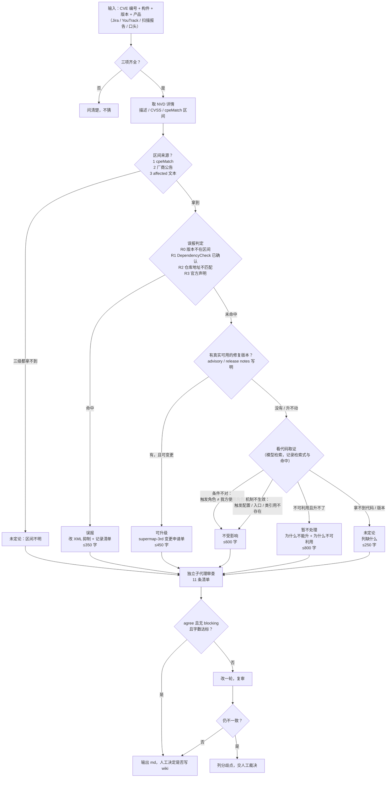

# 判定流程

## 取证要求

| 项目 | 要求 |
|---|---|
| 版本 | 标明来源：jar 内 pom.properties / lock 文件 / node_modules / pom 声明，不混用 |
| 引用 | 每条结论给 `file:line` 或检索式 + 命中数 |
| 0 命中 | 必须附检索式、范围、排除目录，并补第二检索（反射 / 字符串 / SPI / XML bean） |
| 配置 | 找到开关算"启用"，明确 0 命中才算"未启用" |
| 多仓库 | 每个仓库独立取证，结论分开写 |

## 顺序为什么是这样

1. **误报先做**：最便宜，且一旦成立，后面所有代码工作都是白做。
2. **升级优先**：能升就升，比论证"不可利用"更稳，也更容易被审批接受。
3. **不受影响靠后**：需要代码证据，成本最高，且结论最容易被质疑。
4. **暂不处理是兜底**：升不了 + 证不出可利用，两件事都要有依据。
